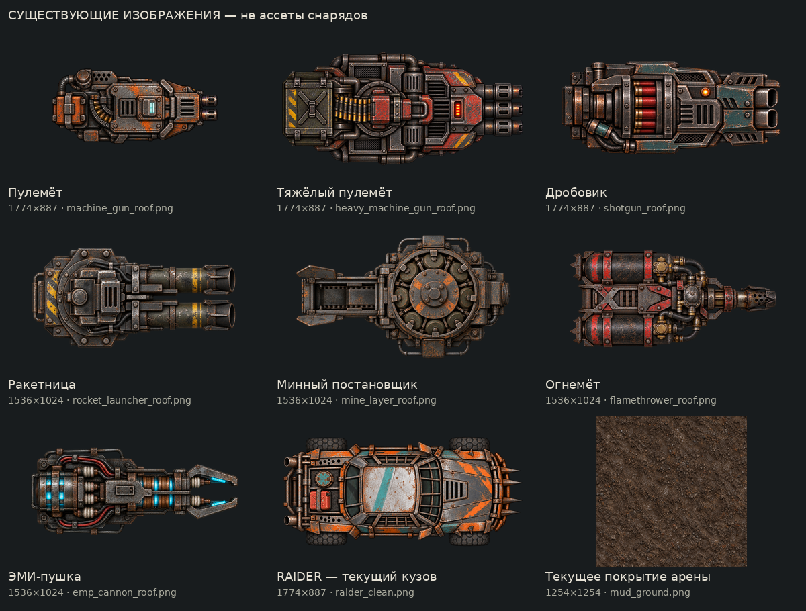
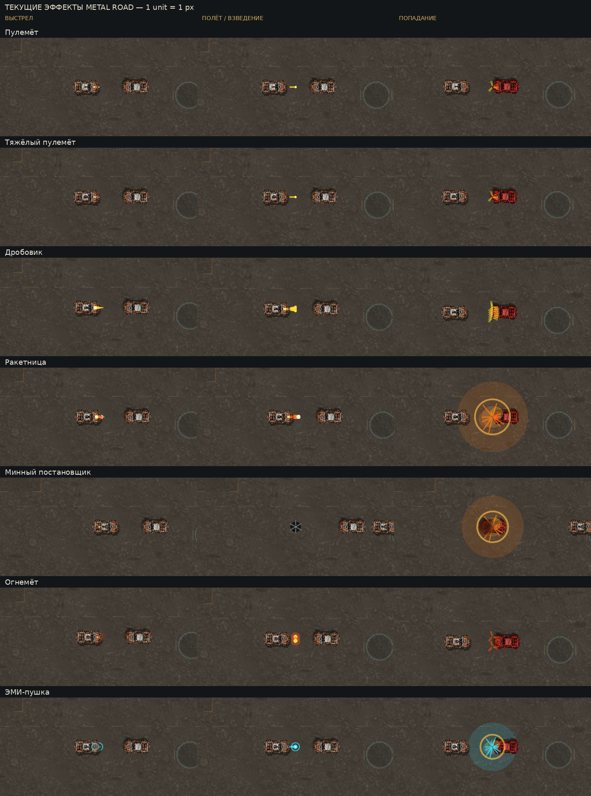

# Metal Road — Weapon Visual Assets Audit

Дата: 2026-10-28. Godot4.7.2 stable Flathub, текущий снимок HEAD 3b8a9bc, ветка codex/tactical-wave-identity-v1. Это аудит и спецификация будущего арт-пакета. Игровые исходники, конфигурации, существующие изображения и баланс не изменялись. Генерация новой графики, commit, push и merge не выполнялись. Новые файлы находятся только в docs/reports/: отчёт и материалы аудита.

## 1. Главный технический вывод

Все семь стандартных оружий используют **одну сцену Bullet — Node2D без Sprite2D, AnimatedSprite2D, физического тела или CollisionShape2D**. Снаряд, его текущий прямой «хвост», вспышка и общий impact/explosion рисуются командами CanvasItem. Семь существующих roof PNG являются модулями на крыше/иконками; они **не являются изображениями пуль**.

Источники: [scenes/Bullet.tscn](../../scenes/Bullet.tscn), [scenes/Vehicle.tscn:62](../../scenes/Vehicle.tscn#L62), [scripts/bullet.gd:277](../../scripts/bullet.gd#L277), [scripts/machine_gun.gd:186](../../scripts/machine_gun.gd#L186), [scripts/combat_vfx.gd:53](../../scripts/combat_vfx.gd#L53). Общий путь оружия — Vehicle/MachineGun, отдельные сцены Rocket/Mine/Flame/EMP в scenes/ не обнаружены. WeaponType имеет6 значений, поскольку обычный и тяжёлый пулемёты оба BALLISTIC. Для семи отдельных художественных профилей нужен weapon_id, а не только weapon_type.

Состав штатных семи подтверждён BonusWeaponCache.PATHS ([scripts/bonus_weapon_cache.gd](../../scripts/bonus_weapon_cache.gd)). В resources/weapons/ есть также biker_pistol.tres и referee_flamethrower.tres — специальные пистолеты байкеров и огонь Арбитра, не часть нового стандартного арт-пакета. Общий renderer при замене должен сохранить для них прежний fallback.

## 2. Реальная цепочка создания, координат и попадания

1. Vehicle.apply_control передаёт fire в MachineGun.set_firing. MachineGun._physics_process:60 проверяет enabled/cooldown/ammo/reload/global bullet count и вызывает _shoot:85.
2. _shoot создаёт projectiles_per_shot экземпляров bullet_scene, добавляет их в первый узел группы bullets (Bullets в Main/ArenaBattle), затем Bullet.setup:23 копирует значения WeaponConfig. Это общий контейнер мира, а не ребёнок движущейся машины.
3. Начало выстрела — MachineGun.get_muzzle_position:151: shooter.to_global(Vector2(min(muzzle_offset,0.46×config.length),0)). Для мины отдельная задняя точка shooter.to_global(Vector2(−0.44×length,0)). Все семь ресурсов имеют muzzle_offset22; у штатного Raider length40 фактическая передняя точка +18.4, задняя −17.6.
4. Bullet.rotation=direction.angle(), local+X вперёд. Скорость=направление×bullet_speed. Ракета обновляет rotation вместе с homing в _guide_rocket:238. Пламя дополнительно наследует линейную скорость автомобиля; мина —12% скорости носителя, тормозит до нуля со180 unit/s² и визуально вращается0.8 рад/с.
5. У обычных Bullet/Bullets z=0; мина получает z=−1. MachineGun — ребёнок Vehicle с обычным относительным z=0, рисуется после родительского кузова/модуля. CombatVFX в обеих игровых сценах z=4; VehicleEffects также z=4 относительно машины. Результат/HUD находятся в CanvasLayer. Sprite-материалов/шейдеров/частиц непосредственно у Bullet и MachineGun нет.
6. Физика снаряда находится в Bullet._physics_process:54: перемещение позиции, TTL, проверки destructibles, StaticBody2D через точечный query, crew и машин. Машина проверяется аналитически: её локальный прямоугольник half_length=length×1.63/2, half_width=width×1.58/2 и расстояние от ближайшей точки до центра Bullet≤radius. Это не alpha-mask новой картинки и не круглый collider узла. Для crew используется отрезок предыдущая→новая позиция и radius+7.
7. Мина взрывается только после age≥effect_duration и контакта с chassis по той же модели radius+прямоугольник. Splash radius используется уже для мгновенного урона в _detonate:184, с падением урона по расстоянию. Crew не взводит мину сам, но может пострадать от её blast.
8. Текстура, её прозрачные края, размер Sprite2D и длина визуального хвоста не должны участвовать в этих проверках. Нельзя заменить реальные shotgun/flame Bullet одним GPUParticles2D-эмиттером: потеряются прежние индивидуальные попадания.

Активный лимит MachineGun._active_bullet_count:159 считает **все Bullet в общем контейнере**, включая чужие оружия и ещё видимый взорвавшийся Bullet. Это не отдельный пул на одного стрелка. Конкретный gun сравнивает этот общий count со своим max_active_bullets. При будущей замене изображений нельзя незаметно менять владельца/тип узла или освобождать взорвавшийся Bullet раньше.

### 2.1. Фактические параметры семи ресурсов

Значения ниже выгружены из загруженных WeaponConfig, включая отсутствующие в .tres поля с defaults из weapon_config.gd. Размеры в мировых units, время в секундах. Номинальный путь v×TTL — верхняя оценка без контакта; проверка TTL выполняется до проверки попадания последнего tick. effective_range — отдельная тактическая дальность, не автоматическая длина анимации/полёта.

| WeaponConfig | Тип | Снарядов/выстрел | Скорость / TTL | radius / trail | splash | effect_duration | effective_range | max_active |
|---|---|---:|---|---|---:|---:|---:|---:|
| [resources/weapons/machine_gun.tres](../../resources/weapons/machine_gun.tres) | BALLISTIC | 1 | 700 / 0.9 | 3 / 14 | 0 | 0 | 480 | 20 |
| [resources/weapons/heavy_machine_gun.tres](../../resources/weapons/heavy_machine_gun.tres) | BALLISTIC | 1 | 630 / 0.9 | 3 / 14 | 0 | 0 | 520 | 36 |
| [resources/weapons/shotgun.tres](../../resources/weapons/shotgun.tres) | SHOTGUN | 6 | 560 / 0.55 | 3 / 14 | 0 | 0 | 250 | 24 |
| [resources/weapons/rocket_launcher.tres](../../resources/weapons/rocket_launcher.tres) | ROCKET | 1 | 380 / 2.3 | 5 / 22 | 105 | 0 | 680 | 8 |
| [resources/weapons/mine_layer.tres](../../resources/weapons/mine_layer.tres) | MINE | 1 | 1 / 12 | 9 / 0 | 92 | 0.55 | 90 | 12 |
| [resources/weapons/flamethrower.tres](../../resources/weapons/flamethrower.tres) | FLAME | 2 | 270 / 0.5 | 7 / 5 | 0 | 0 | 150 | 34 |
| [resources/weapons/emp_cannon.tres](../../resources/weapons/emp_cannon.tres) | EMP | 1 | 530 / 1.25 | 5 / 18 | 72 | 3.2 | 540 | 8 |

У MG/HMG одинаковы radius3, trail14 и bullet_color(1,0.85,0.2); разница урона/скорострельности сейчас не даёт отдельного художественного образа пули. Shotgun создаёт6 отдельных дробин равномерным веером от−0.18 до+0.18 рад. Flame создаёт2 пакета на выстрел при7 Гц: это дискретные сгустки, не непрерывная поражающая Area2D. У неподвижного огнемёта относительный путь270×0.5=135, хотя effective_range150. Остальные nominal paths: MG630, HMG567, shotgun308, rocket874 по траектории, EMP662.5. Mine bullet_speed1 и lifetime12 действительно загружаются, несмотря на более узкие Inspector export_range; менять их «для соответствия диапазону» нельзя.

### 2.2. Текущая отрисовка для каждого оружия

Все строки создаются одним MachineGun._shoot → Bullet.setup. PNG/AnimatedSprite/Sprite/shader/particles для летящего снаряда **нет во всех семи**; источник изображения — конкретная ветка Bullet._draw:277.

| Оружие | Снаряд и фактический размер/цвет | Хвост | Вспышка и попадание |
|---|---|---|---|
| Пулемёт | Цветной круг r3 и белый центр r1.35; жёлтый(1,.85,.2) | Прямая local−X линия14, ширина2.7 | Треугольник/белый круг MachineGun._draw, timer0.065; impact7 линий0.24 с |
| Тяжёлый пулемёт | Та же геометрия и цвет, что у MG | Та же линия14×2.7 | Та же геометрия muzzle/timer0.065 и общий impact; large_hit не передаётся |
| Дробовик | Те же круги r3,6 экземпляров по spread; тот же жёлтый | По14×2.7 у каждой дробины | Muzzle nominal длина24, timer0.11; до6 отдельных impact в одной точке, не одно большое событие |
| Ракетница | Rect(−6,−5,13,10) и нос-круг r5 в x7: корпус занимает примерно x−6…12/y±5; оранжевый(1,.48,.1), нос серо-белый | Оранжевая линия x−22…−5, ширина7.5; не частицы дыма | Muzzle24/timer0.11; generic explosion R105 + per-target impact + собственные круги detonated Bullet |
| Мина | Тёмный диск r13,6 спиц от5 до15 толщиной2.2, центр r3.5; hit r9 меньше картинки | Нет; z−1, остаточный дрейф/вращение | Задняя generic muzzle0.065; после реального chassis-контакта explosion R92 + hit events |
| Огнемёт | Два круга на пакет: внешний r11.2/alpha.42, внутренний r4.9/светло-жёлтый; основной цвет(1,.32,.04) | Поле trail5 скопировано, но FLAME-ветка возвращается до общей линии: видимого хвоста нет | Muzzle14/timer0.065; общий impact, без штатного blast/ground burn decal |
| ЭМИ-пушка | Корона r10 с12 сегментами/толщиной2 + круг r5/белый центр r2.25; cyan(.2,.9,1) | Прямая линия18×4.5 | Кольцо у сопла, timer0.065; generic explosion R72 + per-target impacts и apply_emp3.2 с |

Muzzle._draw использует intensity=clamp(muzzle_flash_time/0.08,0,1). Пулемёт/мина/flame имеют timer0.065, поэтому начальная intensity≤0.8125, а не1. Polygon задан от x=muzzle−2 до muzzle+14×I (для shotgun/rocket24×I), y±5×I; белый круг в muzzle+2 радиус4×I. EMP рисует arc радиуса14×I/толщиной2.2. Все координаты локальны MachineGun и наследуют положение/поворот машины. Это VFX, не увеличение barrel/collider.

У мины обнаружено расхождение intended visual state/реального кадра: _draw выбирает серый до age0.55 и bullet_color после, но Bullet не запрашивает queue_redraw на переходе. В графическом кадре age0.65 мина всё ещё серая, а в следующем контакте реально взрывается. Изображение не перекрашивалось ради аудита; при будущей интеграции индикатору нужен визуальный update по уже существующему age, без изменения арминга. При самой установке мина находится внутри силуэта задней части машины и под ней по z; это не недостаток PNG, который решится только заменой текстуры.

## 3. Вспышки, impact и вторичные эффекты

- MachineGun.muzzle_flash_time и _draw:186 — единственный штатный flash выстрела всех семи. Звук fired не является изображением. Вспышка отдельной сцены/картинки не имеет.
- CombatVFX.spawn_impact:27 — radius28, duration0.24,7 радиальных draw_line; обычный Priority.IMPACT. Вызовы Bullet не используют large_hit=true даже для HMG. Нельзя связывать новый тяжёлый арт с повышением priority без отдельного решения.
- spawn_explosion:23 —0.48 с,3 полупрозрачных круга, золотистая расширяющаяся дуга и11 искр. radius получает105/92/72. Цвет частично из bullet_color, но core/ring жёстко тёплые: нынешний EMP также получает золотой обод.
- Bullet._detonate отдельно рисует2 круга и Tween scale→2.4 за0.14, alpha→0 за0.18 параллельно; Bullet остаётся до callback queue_free. Поэтому большой заполненный круг в кадре взрыва не принадлежит только CombatVFX.
- _apply_hit:162 вызывает impact, take_weapon_damage и для EMP apply_emp. Vehicle.take_damage:191 добавляет VehicleEffects.impact и красную анимацию hit_flash из Vehicle.tscn; EMP-статус рисует Vehicle._draw_emp_feedback:865 до конца отключения. Это дополнительные слои поверх общего impact.
- VehicleEffects.emitter:60 создаёт GPUParticles2D с runtime GradientTexture2D16×16 + GradientTexture1D, ParticleProcessMaterial; файлов smoke/spark textures для этих эмиттеров нет. Это существующие частицы повреждения автомобиля, не текстуры снарядов. При попадании работают spark burst/локальный flash, при тяжёлых повреждениях — smoke/flame; их замена автоматически для всех машин не входит в первый оружейный арт-пакет.

### 3.1. Где impact реально вызывается

| Ветка Bullet | Результат |
|---|---|
| _check_vehicle_hit → _apply_hit | Обычный impact; splash-оружие вызывает _detonate, затем impact на каждую поражённую машину |
| _hits_obstacle → _impact | Обычный impact либо explosion, в зависимости от splash_radius |
| _check_crew_hit | Обычный impact в contact либо _detonate; ущерб crew по существующему коду |
| _check_destructible_hit без splash | take_damage + queue_free; прямого вызова CombatVFX.spawn_impact здесь нет |
| TTL истёк | queue_free; штатного explosion/impact на истечении TTL нет |

Отсутствующий вызов в destructible-ветке нельзя «починить PNG»: если будущий дизайн требует такой визуальный контакт, понадобится отдельное добавление только visual event в этой ветке. Сейчас код не менялся. Blast применяет урон мгновенно на всём R, а расширяющаяся картинка — последующее отображение, не распространяющийся фронт поражения.

CombatVFX.events хранит world_position, но _draw использует её напрямую как локальную: текущие узлы находятся под корнем с единичным transform. При переносе в отдельный трансформированный parent надо учитывать to_local; HUD CanvasLayer не подходит для привязки мировых взрывов.

Budget MAX_EVENTS48 ограничивает только словарь CombatVFX.events, не пули и не частицы VehicleEffects. Explosions/pickups IMPORTANT, обычные hits IMPACT; старейшее событие низшего приоритета вытесняется первым. При будущем pooled Sprite renderer очередь/TTL/приоритеты должны остаться прежними.

## 4. Существующие изображения и места использования

Результат обхода assets/:7 PNG в assets/weapons/, по одному roof на оружие. Все RGBA, с прозрачностью и запечённым освещением/контактными тенями. Отдельных файлов projectile/muzzle/impact/explosion для штатного оружия не обнаружено. Shader среди игровых weapon-компонентов отсутствует; имеющийся assets/ui/menu/menu_overlay.gdshader относится к меню.

| Файл, действительно существующий | Размер PNG | Область alpha>128 | Модуль на Raider,unit |
|---|---:|---|---|
| [assets/weapons/machine_gun/machine_gun_roof.png](../../assets/weapons/machine_gun/machine_gun_roof.png) | 1774×887 | [307, 171, 1472, 701] | 15.82×7.91 |
| [assets/weapons/heavy_machine_gun/heavy_machine_gun_roof.png](../../assets/weapons/heavy_machine_gun/heavy_machine_gun_roof.png) | 1774×887 | [38, 53, 1728, 850] | 17.20×8.60 |
| [assets/weapons/shotgun/shotgun_roof.png](../../assets/weapons/shotgun/shotgun_roof.png) | 1774×887 | [115, 121, 1653, 770] | 16.51×8.26 |
| [assets/weapons/rocket_launcher/rocket_launcher_roof.png](../../assets/weapons/rocket_launcher/rocket_launcher_roof.png) | 1536×1024 | [72, 164, 1456, 841] | 19.95×13.30 |
| [assets/weapons/mine_layer/mine_layer_roof.png](../../assets/weapons/mine_layer/mine_layer_roof.png) | 1536×1024 | [42, 76, 1500, 912] | 20.64×13.76 |
| [assets/weapons/flamethrower/flamethrower_roof.png](../../assets/weapons/flamethrower/flamethrower_roof.png) | 1536×1024 | [75, 180, 1477, 839] | 19.26×12.84 |
| [assets/weapons/emp_cannon/emp_cannon_roof.png](../../assets/weapons/emp_cannon/emp_cannon_roof.png) | 1536×1024 | [63, 214, 1476, 809] | 19.26×12.84 |

WeaponConfig.texture/preview_scale управляют roof presentation. Vehicle._draw_active_weapon:874 масштабирует PNG в центр машины, ограничивая высоту62% визуальной ширины; это draw_texture_rect, не Sprite2D. Фактический visual_size Raider68.8×41.28, при физическом config40×24.

Тот же Texture2D передаётся Vehicle.get_hud_state → scripts/vehicle_readout.gd:update_vehicle в TextureRect и BonusPickup._draw:190 (иконка до54×32 на ящике). Нельзя записать новую картинку ракеты в существующее поле texture: ракета появится на крыше и в HUD вместо модуля. Garage/PreRace используют GarageVehiclePreview и сейчас вызывают set_weapon(null); scripts/weapon_preview.gd содержит старую процедурную схему, но ссылки на этот script/класс в текущих сценах и вызывающем коде не найдены. Он не является источником летящих пуль.

## 5. Графические кадры текущего состояния

Съёмка выполнена реальным графическим Godot/OpenGL на RX580. Стенд в отдельной /tmp-копии использует неизменённые Arena.tscn, Vehicle.tscn, Bullet.tscn, MachineGun и CombatVFX; два обычных Raider100 HP, без усиления урона/HP и без изменённых WeaponConfig. Координатор Survival/AI/HUD отключением не патчился: стенд просто собирает нужные настоящие игровые узлы без координатора. Вызван штатный _shoot для одного burst; попадание проходит реальные _check_vehicle_hit/_mine_has_target и _detonate/_apply_hit. Ручного игрового прохождения не было.

Viewport1280×720, camera zoom1,1 unit=1 px, одинаковая арена/масштаб/позиции для сравнения. Штатный FollowCamera resting_zoom1.23 и maximum_speed_zoom1.0; стенд фиксирует последний масштаб. Full PNG не увеличены. Отдельный лист detail — те же pixels в2× nearest-neighbor, не новые ассеты и не улучшенная вручную графика. Только подписи/монтаж.

Мину после установки показывают без закрывающего её шасси: стрелок переставлен дальше, а после age0.65 цель помещена в контакт с настоящей миной. Прямой вызов _detonate не использовался. Это постановочный контроль контактного взрыва, не естественный проезд. Для огнемёта дополнительно снято удержание реального огня0.4 с.

Сохранение PNG отложено до конца серии. Первый вариант писал PNG сразу и задерживал симуляцию, из-за чего короткий impact успевал исчезнуть; его manifest/log сохранены как initial-*. Финальная проверка capture-checks.json: у всех7 fire имеет muzzle и Bullet, flight имеет Bullet, impact — реальное повреждение и активный VFX.

[Увеличенный сравнительный лист2×](weapon-visual-assets-evidence/comparison-detail-2x.png)

| Оружие | Выстрел | Полёт / взведение | Попадание | HP цели после одиночного burst |
|---|---|---|---|---:|
| Пулемёт | [PNG](weapon-visual-assets-evidence/machine_gun-fire.png) | [PNG](weapon-visual-assets-evidence/machine_gun-flight.png) | [PNG](weapon-visual-assets-evidence/machine_gun-impact.png) | 95.000 |
| Тяжёлый пулемёт | [PNG](weapon-visual-assets-evidence/heavy_machine_gun-fire.png) | [PNG](weapon-visual-assets-evidence/heavy_machine_gun-flight.png) | [PNG](weapon-visual-assets-evidence/heavy_machine_gun-impact.png) | 87.000 |
| Дробовик | [PNG](weapon-visual-assets-evidence/shotgun-fire.png) | [PNG](weapon-visual-assets-evidence/shotgun-flight.png) | [PNG](weapon-visual-assets-evidence/shotgun-impact.png) | 73.000 |
| Ракетница | [PNG](weapon-visual-assets-evidence/rocket_launcher-fire.png) | [PNG](weapon-visual-assets-evidence/rocket_launcher-flight.png) | [PNG](weapon-visual-assets-evidence/rocket_launcher-impact.png) | 67.580 |
| Минный постановщик | [PNG](weapon-visual-assets-evidence/mine_layer-fire.png) | [PNG](weapon-visual-assets-evidence/mine_layer-flight.png) | [PNG](weapon-visual-assets-evidence/mine_layer-impact.png) | 48.000 |
| Огнемёт | [PNG](weapon-visual-assets-evidence/flamethrower-fire.png) | [PNG](weapon-visual-assets-evidence/flamethrower-flight.png) | [PNG](weapon-visual-assets-evidence/flamethrower-impact.png) | 94.400 |
| ЭМИ-пушка | [PNG](weapon-visual-assets-evidence/emp_cannon-fire.png) | [PNG](weapon-visual-assets-evidence/emp_cannon-flight.png) | [PNG](weapon-visual-assets-evidence/emp_cannon-impact.png) | 94.578 |

У shotgun зарегистрировано6 damage events, flame2, остальных по1. Splash-оружие не обязано снять полный config.bullet_damage с центра цели: центр взрыва расположен на контакте перед кузовом и действует прежний falloff. Дополнительный [непрерывный огнемёт](weapon-visual-assets-evidence/flamethrower-continuous.png). Численные состояния Bullet/мuzzle/events и фактические ages находятся в manifest.json, не выводятся только по картинке.

## 6. Художественное направление

Существующая графика — детализированный верхний вид: ржавый металл, сварные накладки, потёртая краска, болты, запечённые контактные тени, приглушённый земляной фон. Roof-модули согласованы с кузовами по материалам и в основном ориентированы стволами вправо; минный модуль рассчитан на задний выпуск. Жёлто-оранжевые вспышки/искры и cyan EMP — уже читаемый язык оружия.

У летящих FX сейчас нет такой фактуры: MG/HMG одинаковы, flame — круги, взрыв — заполненные диски и дуга. Это видно на сравнении. Новый пакет должен дать направленность, горячую сердцевину, фактуру дыма и обломков, мягкие прозрачные края и различимую форму; не закрывать машину непрозрачной цветной плашкой. EMP должен оставаться электрическим/cyan, а не наследовать общий золотистый обод.

Динамических PointLight2D/DirectionalLight2D/WorldEnvironment в проверенных игровых сценах/скриптах не обнаружено. «Свечение» сейчас — цвет/alpha и имитация в изображении, а не освещение соседнего грунта. Нормали/PBR/полноэкранная рефракция не требуются для совместимости первого пакета. Авторские PNG/атласы, а не ещё один набор нарисованных кругов/треугольников, должны стать итоговым изображением. В этом задании никакие новые художественные картинки не создавались.

## 7. Полная спецификация будущих изображений

**Все пути в этом разделе предложены и сейчас не существуют.** Ни PNG, ни .tres/.tscn ниже не создавались. Машинные поля каждого изображения есть в proposed-asset-spec.json; это документ спецификации, не игровой Resource.

Общий контракт каждой строки: PNG RGBA8 sRGB, полностью прозрачный фон, straight alpha (без чёрной подложки/premultiplication), lossless import. Минимум4 прозрачных pixels внутри границы ячейки, один размер и pivot на всех кадрах. Размер «в мире» — размер визуальной канвы при zoom1, а не collider. Pivot дан в pixels исходной ячейки; ему соответствует указанный anchor в мире. При упаковке нельзя потерять origin/прозрачные поля. Текущий стиль цвета сохранять отдельным emissive layer/маской; металл не окрашивать целиком в bullet_color.

Поставлять atlas PNG и frame metadata/SpriteFrames mapping, при необходимости авторский исходник отдельно от runtime. Для4 кадров сетка2×2,6 —3×2,8 —4×2. Например blast256×256×8 даёт1024×512 PNG до дополнительного packing. Looping только там, где указан; остальные кадры выбираются по уже существующему timer/age, без продления события.

### 7.1. Статические изображения

| ID / предлагаемый путь внутри assets/vfx/weapons/ | Назначение | PNG,px | Канва,unit / pivot,px | Anchor / ориентация | Связь с попаданием |
|---|---|---:|---|---|---|
| S01 / machine_gun/projectile_core.png | Ядро обычного трассера | 64×32 | 16×8 / [32, 16] | Центр Bullet / центр попадания; +X вправо | Непрозрачное ядро ≤6 в диаметре; r=3 |
| S02 / heavy_machine_gun/projectile_core.png | Отличимый рисунок тяжёлого трассера | 96×32 | 20×8 / [48, 16] | Центр Bullet / центр попадания; +X вправо | Ядро также ≤6; r=3, не увеличивать collider |
| S03 / shotgun/pellet.png | Одна дробина, повторяется 6 раз | 32×32 | 8×8 / [16, 16] | Центр Bullet / центр попадания; +X вправо | r=3 для каждой из6 отдельных Bullet |
| S04 / rocket_launcher/projectile_body.png | Корпус ракеты с читаемым носом | 96×64 | 24×16 / [32, 32] | Центр Bullet / центр попадания; +X вправо | Pivot — центр проверки r=5; тело около18×10, нос не определяет контакт |
| S05 / mine_layer/mine_body.png | Металлический корпус и лепестки мины | 128×128 | 34×34 / [64, 64] | Центр Bullet / центр попадания; Радиальная; наследовать нынешнее вращение0.8 рад/с | Контакт r=9; корпус26/лепестки≈30 — косметика |
| S06 / mine_layer/indicator_mask.png | Отдельная маска индикатора взведения | 32×32 | 8×8 / [16, 16] | Центр Bullet / центр попадания; Радиальная | Только переключение по age≥0.55; не таймер взведения |
| S07 / shared/tracer_strip.png | Текстурный след обычных пуль/ЭМИ | 128×16 | L=14 или18; ширина=0.9r / [128, 8] | Правый конец в центре Bullet, полоса вдоль −X; +X вправо | Только след: область попадания не растягивается |
| S08 / rocket_launcher/exhaust_strip.png | Огненная сердцевина выхлопа ракеты | 64×32 | 17×10; светящееся ядро шириной7.5 / [64, 16] | Правый конец в Bullet local(−5,0), до local x=−22; +X вправо | Без дополнительного урона по хвосту |

S01–S06 — Sprite2D дочернего визуального узла; S07/S08 — текстурированная полоса (Line2D/quad/mesh или draw_texture_rect_region). Dynamic geometry/UV может оставаться процедурной; финальный вид полосы приходит из изображения. S06 окрашивается/переключается по age≥effect_duration, не из анимационного сигнала «оружие взвелось».

### 7.2. Анимированные спрайты

| ID / предлагаемый atlas внутри assets/vfx/weapons/ | Назначение | Кадр,px / кадров | Канва,unit / pivot,px | Срок / anchor / направление | Связь с попаданием |
|---|---|---|---|---|---|
| A01 / flamethrower/packet_sheet.png | Органический пакет горящей смеси | 96×96 / 8 | 26×26 / [48, 48] | 0.5с, non-loop; Центр Bullet / центр попадания; +X вправо | Контакт r=7; ядро≤14, внешнее свечение декоративно |
| A02 / emp_cannon/packet_sheet.png | Электрический сгусток/корона | 96×96 / 6 | 24×24 / [48, 48] | loop12fps, пока жив Bullet; Центр Bullet / центр попадания; +X вправо | Контакт r=5; кольцо≈22 не collider |
| M01 / machine_gun/muzzle_sheet.png | Вспышка выстрела | 64×64 / 4 | 24×24 / [16, 32] | 0.065с, non-loop; MachineGun local(min(muzzle_offset,0.46 длины),0); +X вправо | Никакой hit area; срок по существующему muzzle_flash_time |
| M02 / heavy_machine_gun/muzzle_sheet.png | Вспышка выстрела | 64×64 / 4 | 24×24 / [16, 32] | 0.065с, non-loop; MachineGun local(min(muzzle_offset,0.46 длины),0); +X вправо | Никакой hit area; срок по существующему muzzle_flash_time |
| M03 / shotgun/muzzle_sheet.png | Вспышка выстрела | 96×64 / 6 | 36×24 / [16, 32] | 0.11с, non-loop; MachineGun local(min(muzzle_offset,0.46 длины),0); +X вправо | Никакой hit area; срок по существующему muzzle_flash_time |
| M04 / rocket_launcher/muzzle_sheet.png | Вспышка выстрела | 96×64 / 6 | 36×24 / [16, 32] | 0.11с, non-loop; MachineGun local(min(muzzle_offset,0.46 длины),0); +X вправо | Никакой hit area; срок по существующему muzzle_flash_time |
| M05 / mine_layer/muzzle_sheet.png | Пыль выпуска мины | 64×64 / 4 | 24×24 / [32, 32] | 0.065с, non-loop; Задняя точка −0.44 длины шасси; Радиальная | Никакой hit area; срок по существующему muzzle_flash_time |
| M06 / flamethrower/muzzle_sheet.png | Вспышка выстрела | 64×64 / 4 | 24×24 / [16, 32] | 0.065с, non-loop; MachineGun local(min(muzzle_offset,0.46 длины),0); +X вправо | Никакой hit area; срок по существующему muzzle_flash_time |
| M07 / emp_cannon/muzzle_sheet.png | Электрическая вспышка у сопла | 64×64 / 4 | 32×32 / [32, 32] | 0.065с, non-loop; MachineGun local(min(muzzle_offset,0.46 длины),0); Радиальная | Никакой hit area; срок по существующему muzzle_flash_time |
| I01 / shared/impact_metal_light_sheet.png | Лёгкие искры/осколки контакта | 128×128 / 6 | 56×56 / [64, 64] | 0.24с, non-loop; Центр Bullet / центр попадания; Радиальная; направление можно передать только как VFX metadata | Канва2×28 не область нанесения урона |
| I02 / shared/impact_metal_heavy_sheet.png | Более массивная фактура контакта HMG | 128×128 / 6 | 56×56 / [64, 64] | 0.24с, non-loop; Центр Bullet / центр попадания; Радиальная; направление можно передать только как VFX metadata | Канва2×28 не область нанесения урона |
| I03 / shared/impact_burn_sheet.png | Короткий контакт горящей смеси | 128×128 / 6 | 56×56 / [64, 64] | 0.24с, non-loop; Центр Bullet / центр попадания; Радиальная; направление можно передать только как VFX metadata | Канва2×28 не область нанесения урона |
| I04 / shared/impact_electric_sheet.png | Электрический контакт с машиной | 128×128 / 6 | 56×56 / [64, 64] | 0.24с, non-loop; Центр Bullet / центр попадания; Радиальная; направление можно передать только как VFX metadata | Канва2×28 не область нанесения урона |
| E01 / rocket_launcher/explosion_sheet.png | Взрыв/разряд в мире | 256×256 / 8 | 210×210 / [128, 128] | 0.48с, non-loop; World position события CombatVFX; Радиальная | Урон уже применён мгновенно по R=105; анимация не распространяет урон |
| E02 / mine_layer/explosion_sheet.png | Взрыв/разряд в мире | 256×256 / 8 | 184×184 / [128, 128] | 0.48с, non-loop; World position события CombatVFX; Радиальная | Урон уже применён мгновенно по R=92; анимация не распространяет урон |
| E03 / emp_cannon/discharge_sheet.png | Взрыв/разряд в мире | 256×256 / 8 | 144×144 / [128, 128] | 0.48с, non-loop; World position события CombatVFX; Радиальная | Урон уже применён мгновенно по R=72; анимация не распространяет урон |

Для M01–M07 нельзя запускать анимацию от удержания fire во время cooldown/reload: ориентир — существующий muzzle_flash_time/fired. Точная шкала интенсивности может по-прежнему использовать current timer/0.08. A01 заканчивается с Bullet TTL0.5, A02 может loop до TTL1.25; конец SpriteFrames не наносит урон и не удаляет снаряд раньше.

I01/I02/I03/I04 отображают существующие impact0.24. E01/E02/E03 — существующие explosion0.48. Канва blast соотнесена с2R, но прозрачные поля/пламя не задают точную поражающую кромку. Весь splash damage уже произошёл в момент _detonate. Если нужен точный служебный контур R, он должен читаться из существующего значения отдельно от текстуры.

### 7.3. Частицы — дополнительная полировка после базового пакета

| ID / предлагаемый путь внутри assets/vfx/weapons/ | Текстура | PNG,px | Размер частицы,unit / pivot,px | Anchor / ориентация | Контракт |
|---|---|---|---|---|---|
| P01 / shared/smoke_puff.png | Фактурный клуб дыма для выхлопа/взрыва | 128×128 | Начало8–18; финал20–40 / [64, 64] | Ограниченный world-space emitter; Радиальная; случайный визуальный угол | RGBA PNG,1 кадр, GPUParticles2D; без hit area |
| P02 / shared/spark_streak.png | Частица вытянутой металлической искры | 64×16 | 4×1…10×2 / [32, 8] | Контакт/взрыв; +X вдоль скорости частицы | RGBA PNG,1 кадр, GPUParticles2D; без hit area |
| P03 / shared/ember.png | Короткоживущий уголёк | 32×32 | Диаметр2–5 / [16, 16] | Контакт/взрыв; Радиальная | RGBA PNG,1 кадр, GPUParticles2D; без hit area |

Частицы не обязательны для первого безопасного подключения Sprite-пакета. Если используются: spark/ember lifetime около0.15–0.30 с, smoke около0.30–0.48 с с плавным alpha; это косметические сроки внутри ограниченного visual budget. Не превращать rocket trail в новый поражающий огонь или flame packet в дымовую завесу. World-space emitter должен быть ограниченным и завершать жизнь без orphan после уничтожения Bullet/Restart. Градиенты цвета, fade, scatter и rotation могут оставаться процедурными, текстура частицы — авторская.

### 7.4. Полнота комплекта по семи видам

| Оружие | Снаряд / статус | Muzzle | След | Попадание в машину / blast |
|---|---|---|---|---|
| MG | S01 | M01 | S07,L14/width2.7 | I01 |
| HMG | S02 | M02 | S07,L14/width2.7 | I02, прежний IMPACT priority |
| Shotgun |6×S03 | M03 |6×S07,L14 | До6×I01; не один новый damage event |
| Rocket | S04 | M04 | S08; P01 опционально | E01 + I01 на существующих affected targets |
| Mine | S05+S06 | M05 | Нет | E02 + I01; только после реального armed contact |
| Flame |2×A01 на выстрел | M06 | Отдельный текущий trail не рисуется | I03; ground-fire damage/decal не добавляется |
| EMP | A02 | M07 | S07,L18/width4.5 | E03 + I04 и прежняя длительная status feedback |

Существующие семь roof PNG можно сохранить: замена их на новые изображения не требуется для исправления летящих FX. Если арт-директор захочет редизайн модулей, это отдельный набор с теми же source paths/preview semantics; нельзя использовать для него текстуры из таблицы projectile.

## 8. Предлагаемое хранение и подключение в Godot

Структура ниже — только план:

    assets/vfx/weapons/
      shared/                 # S07,I01–I04,P01–P03
      machine_gun/            # S01,M01
      heavy_machine_gun/      # S02,M02
      shotgun/                # S03,M03
      rocket_launcher/        # S04,S08,M04,E01
      mine_layer/             # S05,S06,M05,E02
      flamethrower/           # A01,M06
      emp_cannon/             # A02,M07,E03
    resources/weapon_visuals/  # 7 отдельных visual profiles, SpriteFrames/material refs
    scenes/vfx/               # при необходимости переиспользуемые visual-only scenes

Предпочтителен отдельный immutable WeaponVisualConfig/профиль с key=weapon_id, SpriteFrames/Texture2D, pivot/size, palette, draw layer. Возможна необязательная ссылка из WeaponConfig или отдельный registry семи id; выбор реализации — следующее задание. Не переиспользовать существующее WeaponConfig.texture, не менять bullet_radius/speed/TTL/range для подгонки картинки.

- Projectile: Sprite2D для5 статических тел, AnimatedSprite2D для flame/EMP. Child visual имеет свой offset/scale; root Bullet продолжает двигаться/попадать и владеть TTL.
- CombatVFX: сохранять словарь events и48-слотовую политику. Минимальный путь — центральный renderer draw_texture_rect_region по общим SpriteFrames и нормализованному age, без отдельной сцены на каждую искру. Альтернатива — bounded pool Sprite nodes на существующие48 событий.
- Muzzle: один переиспользуемый visual child gun, обновляемый штатным timer. Не создавать новую вспышку-сцену каждый physics tick.
- Shader необязателен: небольшой общий CanvasItem material для fade/emissive mask/текстурной полосы, если нужна динамика. Не требовать нового renderer, normal maps, fullscreen refraction или смены освещения. Additive blending только для hot core/glow, не корпуса/дыма.
- GPUParticles2D уже работает в проекте; новые weapon emitters вводить отдельно и ограниченно. Не менять VehicleEffects для всех машин ради одной новой пули.
- world trail history/UV/затухание, homing orientation, arming/status feedback, fade timers и точные служебные radius overlays разумно сохранить процедурными. Текущие примитивные изображения тела/вспышки/взрыва подлежат замене авторским артом.

Для разных impact visuals потребуется передать только VFX metadata weapon_id (при желании angle/surface) в события Bullet._apply_hit/_impact/_detonate. Сейчас CombatVFX API не знает оружие и не получает normal попадания. Сделать новые параметры необязательными, со старым fallback для barrel/crew/perk/pickup/referee callers. Нельзя перекрасить все explosion по одному weapon_type: пострадают специальные оружия и другие системы.

Особенно важно разобрать двойной взрыв: либо два художественных слоя явно делятся между Bullet/CombatVFX, либо взрыв централизуется в CombatVFX и отключается только legacy draw/visual child detonated Bullet. Корневой Bullet всё равно должен прожить прежний parallel Tween~0.18 с перед освобождением, чтобы не поменять общий active count. Новый Sprite взрыва под root scale Tween не должен случайно увеличиваться ещё в2.4 раза поверх уже нарисованных кадров.

## 9. Производительность и ограничения

Спецификация содержит 27 предлагаемых PNG/atlas файлов, включая3 опциональные текстуры частиц. Сумма RGBA8 pixels всех кадров/ячеек без дополнительного padding, mipmaps, driver rounding и компрессии — около 8.79 МиБ. Это **расчёт предлагаемого пакета**, не измеренная VRAM. Mip chain добавит примерно треть, packing/аллокатор могут увеличить объём иначе. Семь нынешних roof PNG сами содержат около42 МиБ RGBA8 исходных pixels; их стоимость нельзя суммировать с независимыми GPU-замерами другого процесса как фактический общий RSS/VRAM.

Основные риски: fill-rate прозрачных blast/smoke над множеством машин; случайное дублирование Bullet-core/explosion;7 разных материалов/атласов нарушают batching; создание SpriteFrames/ShaderMaterial/Texture копии на каждый shot; lazy load декодирования PNG в боевом кадре; новые visual RNG вызовы меняют глобальную последовательность spread; частицы продолжают жить после Restart вне cap48.

Загружать и удерживать семь shared visual profiles до активного матча через существующий этап подготовки, а не load в _draw/_shoot. Сильный кэш BonusWeaponCache уже держит штатные WeaponConfig; новые текстуры/frames должны иметь столь же ограниченное владение и переиспользоваться, без копирования для каждого бонуса/пули. Для визуального scatter использовать отдельный RNG, не randf_range глобальной стрельбы. Если вводятся particles, cap их количества/жизни должен быть явным: CombatVFX.MAX_EVENTS сам их не ограничит.

Новый PNG-арт не гарантирует ускорения: нынешние primitives могут batch-иться, а прозрачные спрайты потребляют fill-rate. Фактическое сравнение CPU/GPU/frame p95/p99, RSS/MEMORY_STATIC/RENDER_VIDEO_MEM_USED требуется после подключения пакета, включая первое появление, много shotgun/flame packets,48 VFX,8 AI, Restart и меню. В этом аудите производительность будущих ассетов не измерялась.

## 10. Безопасный план замены

1. Утвердить арт по reference sheet и27-строчной спецификации, в масштабе1:1 и штатном zoom1.23. Сначала проверить читаемость ядра/следа на грязи, кузовах и взрывах, без изменения игровых параметров.
2. Добавить отдельные visual profiles и предзагрузку семи id; оставить совместимый legacy fallback для неизвестных/special weapons.
3. Заменить только отображение Projectile/Muzzle, сохранив root Bullet, groups/parent, weapon_id, число дробин/пакетов, cooldown/ammo, движение, collision checks, TTL и z.
4. Заменить общий FX renderer на кадры/текстурные спрайты под теми же event priorities/count/TTL, передав только визуальные метаданные. Pickup и неоружейные explosion не перерабатывать автоматически.
5. Выделить mine LED визуальное обновление по существующему age, сохранить контактную активацию. Для EMP не терять длительную индикацию3.2 с из-за короткого разряда0.48 с. Проверить flight/muzzle/impact hit timing покадрово.
6. Проверить возврат/Restart, caps, штатные weapon/crew/mine/VFX-budget/Race/Survival/boss/regression сценарии на том же исходнике. Для rendering проверить направление на0/90/180/270°, масштабы/пивоты, контраст, отсутствие atlas bleeding, добавочных node/resource leaks и холодных загрузок.
7. Только после численных и визуальных проверок удалять старые draw-ветки. Не менять Vehicle.physics, collision shapes, AI, damage/range или баланс ради размера арта.

Для первого внедрения предпочтителен Sprite/SpriteFrames-пакет без нового дыма/шейдерной архитектуры. Дополнительные particles вводить отдельной проверяемой полировкой, если арт действительно требует их.

## 11. Что выполнено и что не проверялось

Снято22 реальных графических PNG (7×3 фазы + continuous flame), созданы два сравнительных листа из этих кадров и reference sheet из существующих PNG. В финальной серии все7 имеют реальные попадания и активные impact/explosion в кадре. Шейдеры/новые изображения не генерировались и не подключались. Нет ручного прохождения, оценки будущего финального арта или performance-вывода о ещё не созданном пакете.

Тестовый harness и монтажный script сохранены как .txt внутри evidence, чтобы Godot не импортировал их как новые игровые сценарии. Они запускались только в /tmp-копии. Полный regression runner не запускался: production-код не менялся, это не задача исправления логики. Текущие ошибки/несовпадения арминга и отсутствующий destructible impact документированы, но не исправлены.

Метод, manifest, снимок source hashes и проверка сохранности дерева: [evidence README](weapon-visual-assets-evidence/README.md).
